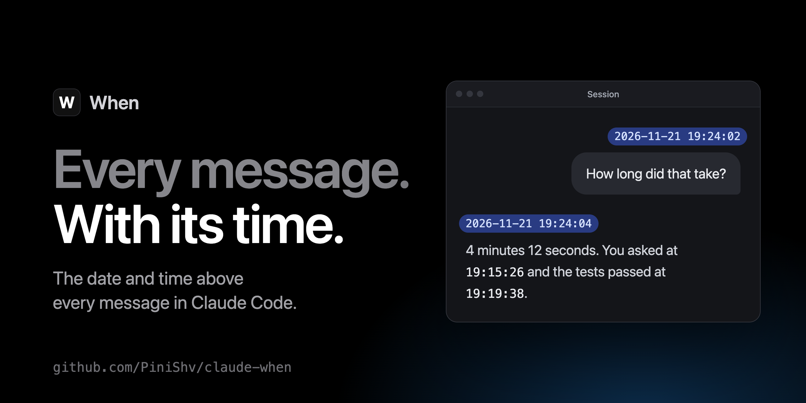
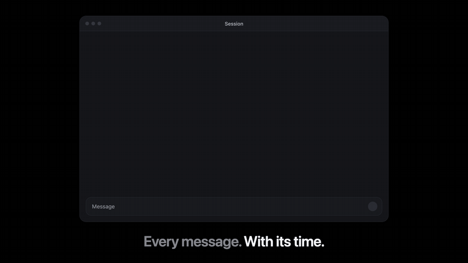

<div align="center">

# When

### Every message. With its time.

**The date and time above every message in Claude Code, yours and Claude's.**


[Website](https://claude-when.pinishv.com) · [Install](#install) · [How it works](#how-it-works) · [Good to know](#good-to-know) · [Changelog](CHANGELOG.md)

```bash
claude plugin install when --marketplace PiniShv/claude-when
```

<a href="https://claude-when.pinishv.com"></a>

</div>

Claude Code does not show when a message was sent. In a long session you cannot
tell when you asked something, or how long a step took. When adds a quiet line
above each message, and tells Claude the time too.

## What it does

- **Your messages and Claude's replies both get a time.** Date and time, in your
  local time zone.
- **A reply's time is when Claude started writing it.** The gap between two lines
  is how long the work took.
- **Claude knows the time too.** Each prompt carries a hidden note with its send
  time. Ask "how long did that take?" and Claude can answer from real times.



## Install

**Desktop app**

1. Click `+` next to the prompt box, then **Plugins**.
2. Choose **Add marketplace** and enter `PiniShv/claude-when`.
3. Choose **Add plugin**.

**Terminal session**

```
/plugin install when --marketplace PiniShv/claude-when
```

**Shell**

```bash
claude plugin install when --marketplace PiniShv/claude-when
```

To update or remove it:

```bash
claude plugin update when@claude-when
```

```bash
claude plugin uninstall when@claude-when
```

## Nothing to trust

- One TypeScript file, about 150 lines. Read it: [hooks/register.tsx](hooks/register.tsx).
- No dependencies.
- No network calls, no telemetry, no account. It reads your computer's clock and
  keeps one time per message in a small file on your computer.

## Good to know

- **Where it works:** the Claude Code desktop app, the terminal and the VS Code
  panel. VS Code draws the time in a small card labelled with the plugin's name.
- **Mobile:** the Claude mobile app does not ask the mod to draw, so you see no
  time line there. Claude still gets the send time of each message you type.
- **What gets a time:** every message with text. A message that is only an image
  gets none, and neither do messages from before you installed When.
- **Saved times:** kept on your computer for the last 20,000 messages. A resumed
  session shows the times of messages sent after When was installed.
- **Version:** needs a Claude Code version that supports mods.

## How it works

When is a mod: a small plugin that draws on Claude Code's own message rows.

1. When you send a prompt, it notes the time and adds it to what Claude reads.
2. The first time a message is drawn, it puts that time on a dim line above the
   message and saves it. A reply's time is the moment Claude started writing it.
3. When you resume a session, the saved times are drawn again.

The transcript is not changed. The time line is drawn on screen only.

## Develop

```bash
claude plugin validate .
```

```bash
claude plugin test .
```

## More

[Contributing](CONTRIBUTING.md) · [Security policy](SECURITY.md) · [Changelog](CHANGELOG.md) · [Code of conduct](CODE_OF_CONDUCT.md)

## License

[Apache License 2.0](LICENSE) © 2026 Pini Shvartsman

When is an independent project. It is not made by or affiliated with Anthropic.
